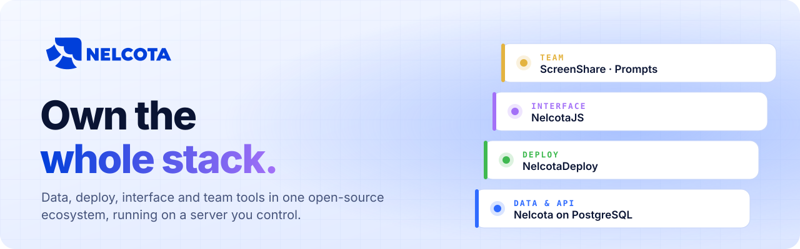

<a href="https://nelcota.com">
  <picture>
    <source media="(prefers-color-scheme: dark)" srcset="https://raw.githubusercontent.com/Nelcota/.github/main/profile/banner-dark.svg">
    
  </picture>
</a>

<div align="center">

[](https://nelcota.com)
[](https://nelcota.com/docs/)
[](https://github.com/Nelcota/Nelcota/releases)
[](https://github.com/Nelcota/Nelcota)

</div>

<h3 align="center">Stop renting your infrastructure. Run all of it yourself.</h3>

<p align="center">
Nelcota is an open-source ecosystem for building and running software end to end:<br>
the database and API, the deploy pipeline, the frontend framework and the tools your team uses every day.<br>
<b>Every piece is self-hosted, so the stack, the data and the bill stay yours.</b>
</p>

<br>

## The stack

<table>
<tr>
<td width="50%" valign="top">

### 🐘 Data &amp; API
**[Nelcota](https://github.com/Nelcota/Nelcota)**

Your PostgreSQL schema becomes a complete backend: REST API, auth, file storage, webhooks and an admin panel, in a single Rust binary. Row-level security decides what every request can do.

 

</td>
<td width="50%" valign="top">

### 🚀 Deploy
**[NelcotaDeploy](https://github.com/Nelcota/NelcotaDeploy)**

Push to GitHub, get a running container with HTTPS, logs, metrics, uptime checks, previews, databases and automatic rollback. One VPS or many over SSH.

  

</td>
</tr>
<tr>
<td width="50%" valign="top">

### ⚛️ Interface
**[NelcotaJS](https://github.com/Nelcota/NelcotaJS)** <sup>pre-alpha</sup>

A reactive frontend framework built on signals: components run once and only the bound DOM nodes update. Secure by default and under 9 kB gzip.

 

</td>
<td width="50%" valign="top">

### 👥 Team
**[NelcotaScreenShare](https://github.com/Nelcota/NelcotaScreenShare)** · **[NelcotaPrompts](https://github.com/Nelcota/NelcotaPrompts)**

Screen sharing with audio and chat, and a private prompt library with variables, version history and full-text search. Tools your team owns instead of subscribes to.

 

</td>
</tr>
</table>

**SDKs:** [`@nelcota/client`](https://github.com/Nelcota/Nelcota/tree/main/sdk/typescript) · [`@nelcota/nextjs`](https://github.com/Nelcota/Nelcota/tree/main/sdk/nextjs) · [`@nelcota/ssr`](https://github.com/Nelcota/Nelcota/tree/main/sdk/ssr) · [`nelcota-client`](https://github.com/Nelcota/Nelcota/tree/main/sdk/rust) for Rust<br>
**Website:** [NelcotaWebsite](https://github.com/Nelcota/NelcotaWebsite), the site and docs in English and Portuguese, built with Astro.

## Try it

```sh
curl -fsSL https://raw.githubusercontent.com/Nelcota/Nelcota/main/scripts/install.sh | NELCOTA_SKIP_DOCKER=1 sh
mkdir my-app && cd my-app
nelcota dev   # PostgreSQL, the API and the admin panel, running locally
```

Write your tables in SQL, run `nelcota migrate` and the API is live. The [quickstart](https://github.com/Nelcota/Nelcota/blob/main/docs/quickstart.md) takes it from there, and the [self-hosting guide](https://github.com/Nelcota/Nelcota/blob/main/docs/deploy.md) puts it in production.

## Why Nelcota

| | |
| --- | --- |
| 🏠 **Yours to run** | Everything runs on a server you control, from a single VPS up. |
| 🧱 **Built on standards** | PostgreSQL, SQL, Docker and web standards instead of proprietary layers. |
| ⚡ **Small and fast** | Single binaries, few moving parts, size and performance budgets enforced in CI. |
| 🛡️ **Secure by default** | Safe defaults out of the box, and the unsafe path is always explicit. |
| 🔓 **No lock-in** | Your data and code stay portable, and [leaving is documented](https://github.com/Nelcota/Nelcota/blob/main/docs/leaving.md). |

## Contribute

Pick a project, read the [contributing guide](https://github.com/Nelcota/.github/blob/main/CONTRIBUTING.md) and open an issue or pull request. Questions go through the [support guide](https://github.com/Nelcota/.github/blob/main/SUPPORT.md), and everyone follows the [code of conduct](https://github.com/Nelcota/.github/blob/main/CODE_OF_CONDUCT.md).

Found a vulnerability? Report it privately through **GitHub Security Advisories** in the affected repository, as described in the [security policy](https://github.com/Nelcota/.github/blob/main/SECURITY.md).

<div align="center">
<br>
<sub><a href="https://nelcota.com">nelcota.com</a> · open source, self-hosted, yours</sub>
</div>
