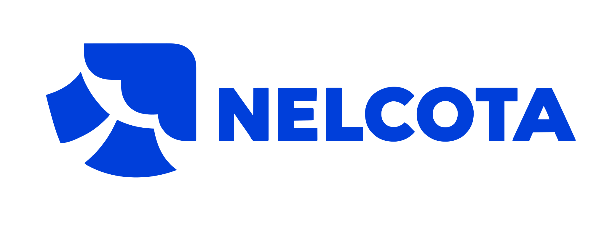

<div align="center">

<picture>
  <source media="(prefers-color-scheme: dark)" srcset="https://raw.githubusercontent.com/Nelcota/.github/main/profile/logo-dark.svg">
  
</picture>

### Open-source tools for small teams. Your server, your data.

A PostgreSQL backend, a deploy panel, a frontend framework and the everyday tools around them,<br>
built to run on a single VPS without vendor lock-in.

[](https://nelcota.com)
[](https://nelcota.com/docs/)
[](https://github.com/Nelcota/Nelcota/releases)
[](https://github.com/Nelcota/Nelcota)

**[Quickstart](https://github.com/Nelcota/Nelcota/blob/main/docs/quickstart.md)** ·
**[Documentation](https://nelcota.com/docs/)** ·
**[Self-hosting](https://github.com/Nelcota/Nelcota/blob/main/docs/deploy.md)** ·
**[Releases](https://github.com/Nelcota/Nelcota/releases)**

</div>

<br>

## ⚡ Nelcota — the backend

> **Plain PostgreSQL + one Rust binary.** Write your schema in SQL and get a ready-to-use backend, deployed to a VPS in minutes.

<table>
<tr>
<td width="50%" valign="top">

- **REST API** generated from your schema, with filters, relations, RPC and OpenAPI
- **Auth** with email/password, magic links, OAuth/OIDC and Ed25519 JWTs
- **Storage** with public and private buckets on disk or S3

</td>
<td width="50%" valign="top">

- **Webhooks** with signed delivery and retries
- **Admin panel** for tables, SQL, migrations, users and files
- **Ops** built in: backups, point-in-time recovery and alerts

</td>
</tr>
</table>

No authorization layer to learn: **PostgreSQL grants and RLS policies decide what every request can do**, and your data stays plain SQL you can [take with you](https://github.com/Nelcota/Nelcota/blob/main/docs/leaving.md).

```
your app ──HTTPS──▶ Caddy ──▶ nelcota (one binary) ──▶ PostgreSQL 17
```

**SDKs:**
[`@nelcota/client`](https://github.com/Nelcota/Nelcota/tree/main/sdk/typescript) ·
[`@nelcota/nextjs`](https://github.com/Nelcota/Nelcota/tree/main/sdk/nextjs) ·
[`@nelcota/ssr`](https://github.com/Nelcota/Nelcota/tree/main/sdk/ssr) ·
[`nelcota-client`](https://github.com/Nelcota/Nelcota/tree/main/sdk/rust) (Rust)

## 🧰 Projects

| | Project | What it does | Stack |
| :-: | --- | --- | --- |
| 🐘 | **[Nelcota](https://github.com/Nelcota/Nelcota)** | Backend-as-a-service on plain PostgreSQL: REST API, auth, RLS, storage, webhooks and an admin panel. |   |
| 🚀 | **[NelcotaDeploy](https://github.com/Nelcota/NelcotaDeploy)** | Self-hosted deploy panel for Linux VPSs with Docker: push to GitHub, get a container with logs, metrics, uptime checks and HTTPS. |   |
| 🧪 | **[NelcotaJS](https://github.com/Nelcota/NelcotaJS)** | Fine-grained reactive frontend framework. Signals instead of re-renders, secure by default, ≤ 9 kB gzip. *Pre-alpha.* |   |
| 🖥️ | **[NelcotaScreenShare](https://github.com/Nelcota/NelcotaScreenShare)** | Screen sharing for small teams, with audio and chat. |   |
| 📝 | **[NelcotaPrompts](https://github.com/Nelcota/NelcotaPrompts)** | Private prompt library for developer teams, with variables, version history and full-text search. |   |
| 🌐 | **[NelcotaWebsite](https://github.com/Nelcota/NelcotaWebsite)** | The website and documentation, in English and Portuguese. Lighthouse 100. |   |

## 🧭 What we believe

- **Self-hosted first.** Everything runs on a server you control, from a single VPS up.
- **Boring, durable foundations.** PostgreSQL, SQL, Docker and web standards over proprietary layers.
- **Small and fast.** Single binaries, few moving parts, size and performance budgets enforced in CI.
- **Secure by default.** Safe defaults out of the box; the unsafe path is always explicit.
- **No lock-in.** Your data and code stay portable, and leaving is documented.

## 🤝 Contribute

Pick a project, read the [contributing guide](https://github.com/Nelcota/.github/blob/main/CONTRIBUTING.md) and open an issue or pull request. Questions go through the [support guide](https://github.com/Nelcota/.github/blob/main/SUPPORT.md), and everyone follows the [code of conduct](https://github.com/Nelcota/.github/blob/main/CODE_OF_CONDUCT.md).

Found a vulnerability? Report it privately through **GitHub Security Advisories** in the affected repository, as described in the [security policy](https://github.com/Nelcota/.github/blob/main/SECURITY.md).

<div align="center">
<br>
<sub><a href="https://nelcota.com">nelcota.com</a> · open source, self-hosted, yours</sub>
</div>
