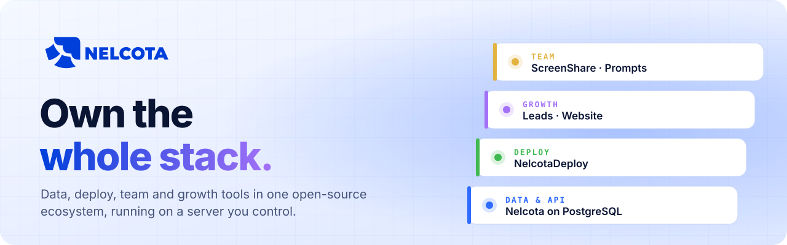

<div align="center">

<a href="https://nelcota.com">
  <picture>
    <source media="(prefers-color-scheme: dark)" srcset="https://raw.githubusercontent.com/Nelcota/.github/main/profile/banner-dark.svg">
    
  </picture>
</a>

A backend on plain PostgreSQL, a deploy panel for your VPS, and apps for the team around them.<br>
No lock-in: your data stays in your database, on a machine you control.

[](https://nelcota.com)
[](https://nelcota.github.io/NelcotaWebsite/docs/)
[](https://github.com/Nelcota/Nelcota)

</div>

## Projects

<table>
<tr>
<td width="50%" valign="top">

#### 🐘 [Nelcota](https://github.com/Nelcota/Nelcota) &nbsp;[](https://github.com/Nelcota/Nelcota/releases)

**Backend-as-a-service on plain PostgreSQL.** One Rust binary gives you a REST API, auth, file storage, webhooks and an admin panel. Row-level security decides what every request can do.

<sub>Rust · PostgreSQL 17 · Svelte · Apache-2.0</sub>

</td>
<td width="50%" valign="top">

#### 🚀 [NelcotaDeploy](https://github.com/Nelcota/NelcotaDeploy) &nbsp;[](https://github.com/Nelcota/NelcotaDeploy/releases)

**Self-hosted deploy panel for a single VPS.** Ship Docker apps from GitHub with deployments, logs, uptime checks and automatic HTTPS, all from one panel.

<sub>TypeScript · Docker · Traefik · SQLite</sub>

</td>
</tr>
<tr>
<td width="50%" valign="top">

#### 🖥️ [NelcotaScreenShare](https://github.com/Nelcota/NelcotaScreenShare)

**Screen sharing for small teams.** Screen with audio, chat, annotations, permanent rooms, team workspaces and host controls, plus a mascot that reacts to you.

<sub>TypeScript · LiveKit · React Router · PostgreSQL</sub>

</td>
<td width="50%" valign="top">

#### 📝 [NelcotaPrompts](https://github.com/Nelcota/NelcotaPrompts)

**Private prompt library for developers.** Variables with defaults, version history, full-text search, a ⌘K palette and MCP access for Claude, Cursor and other AI clients.

<sub>Bun · React Router · Hono · PostgreSQL · MIT</sub>

</td>
</tr>
<tr>
<td width="50%" valign="top">

#### 🎯 [NelcotaLeads](https://github.com/Nelcota/NelcotaLeads)

**Lead generation with AI.** Finds local businesses, scores them from their public website and follows up by email, handing the conversation over once there is interest.

<sub>TanStack Start · Cloudflare Workers · D1 · Queues</sub>

</td>
<td width="50%" valign="top">

#### 🌐 [NelcotaWebsite](https://github.com/Nelcota/NelcotaWebsite)

**Website and docs at [nelcota.com](https://nelcota.com).** English and Portuguese, versioned docs synced from the backend repo, Lighthouse 100 and a strict CSP.

<sub>Astro · Tailwind CSS 4 · Apache-2.0</sub>

</td>
</tr>
</table>

## How they fit together

```
 your apps ──▶ Nelcota (REST · auth · storage · webhooks) ──▶ PostgreSQL
     ▲
     └── NelcotaDeploy ships them to your VPS from GitHub, with HTTPS
```

ScreenShare, Prompts and Leads are the tools we use every day, built in the open on the same principles: self-hosted, standard databases and data you can export at any time.

## What we care about

<table>
<tr>
<td width="33%" valign="top">

#### 🏠 Self-hosted first

Everything runs on a server you own. One VPS is enough.

</td>
<td width="33%" valign="top">

#### 🔓 No lock-in

Plain SQL, standard Postgres and Docker. Take your data and leave whenever you want.

</td>
<td width="33%" valign="top">

#### 🛡️ Secure by default

Row-level security, signed tokens, strict CSP and audit logs from day one.

</td>
</tr>
</table>

## Contribute

Issues and pull requests are welcome on every public repository. Each one has its own setup guide in its README.

[](https://github.com/Nelcota/.github/blob/main/CONTRIBUTING.md)
[](https://github.com/Nelcota/.github/blob/main/SUPPORT.md)
[](https://github.com/Nelcota/.github/blob/main/CODE_OF_CONDUCT.md)

> [!IMPORTANT]
> **Found a vulnerability?** Don't open a public issue. Report it privately through GitHub Security Advisories, as described in the [security policy](https://github.com/Nelcota/.github/blob/main/SECURITY.md).
